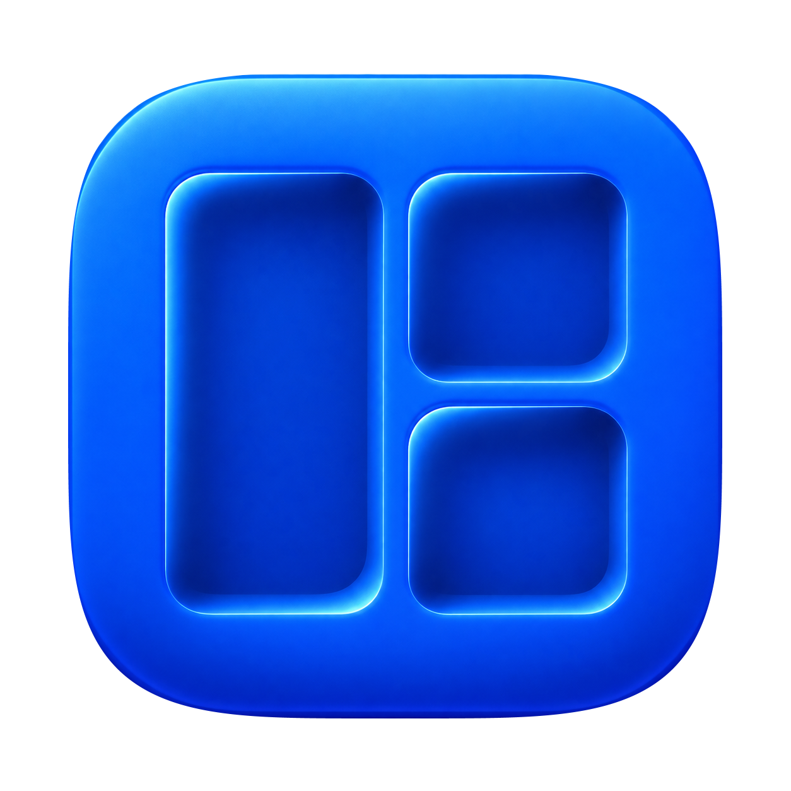

# Window Factory

Version: 1.1
Updated: 2026-10-31



A native macOS app for saving window layouts and working with windows across
Spaces. Built with Swift, AppKit and a small Objective-C system bridge.

- **Capture** the eligible windows on the current desktop as a named layout.
- **Restore** existing windows to a saved layout.
- **Establish here** create supported missing windows, reuse existing matches and
  verify their positions without duplicating them on repeat.
- Use size/position cycles, directional focus, stash/restore, accordion and a
  desktop-grouped window switcher.
- Move a window to an adjacent Space and follow it, with frame/focus checks.
- Enable binary-tree tiling on the current desktop, resize splits, float/rejoin
  windows and restore their previous positions.
- Configure app-launch shortcuts and search applications separately from layouts.
- Use an optional same-user JSON CLI through the running app.

## Getting started

There is no packaged public release yet. Build from source using Xcode's Apple
SDK/Swift compiler and asset compiler (including Icon Composer support), plus the
repository-pinned Node runtime through mise. Current live acceptance is on macOS
27; the bundle declares macOS 14 as its minimum, but that is not a claim of broad
private-API compatibility on every release.

```fish
mise install
mise run validate
mise run test
```

For a local development build with an explicit ad hoc signature:

```fish
env WINDOW_FACTORY_SIGNING_MODE=adhoc mise run build
```

For a stable Developer ID build, copy `signing.example.sh` to the ignored
`signing.local.sh`, fill in your own public signing identity/team and run
`mise run build`. Private key material never belongs in either file.
See [build and update safety](docs/building.md) before installing. The installer
requires Developer ID and refuses an update with a different designated
requirement; an ad hoc build cannot replace an existing stable installation.

Build output defaults to `~/.cache/window-factory/build/Window Factory.app`.
Layouts live in `~/.local/share/window-factory`; settings use the app's preference
domain. Moving the source checkout does not move that data or change permissions.

## Using Window Factory

Open the app and enable Accessibility in System Settings for capture and window
control. Some app creation adapters also need Automation permission. The app does
not grant these permissions itself. Screen Recording is not required for its
layout outlines or current switcher.

Use the menu-bar desktop badge to open the library, application search, tiling,
Settings or Keyboard Shortcuts. Shortcuts are configurable and the reference
window/menu hints follow the saved bindings. A hold-Tab-to-Hyper mapping is an
optional external keyboard setup, not a requirement or bundled remapper.

[Usage and shortcut defaults](docs/usage.md) explains Restore versus Establish,
search/order/Space preview, direct controls and tiling. [CLI.md](CLI.md) describes
agent commands and the Settings access toggle. [App adapters](docs/app-adapters.md)
is the procedure for adding reviewed window-creation support.

## Boundaries and compatibility

Space inventory, cross-Space focus and movement use private macOS capabilities.
Availability checks and live verification matter; a successful API call alone is
not proof that a window moved or focused. Unsupported contexts and interrupted
operations report failures rather than silently selecting another target.

App launch currently activates a running app; it can follow an existing window
to another Space. Use the explicit current-desktop new-window/layout operations
when creation here is intended. Browser URLs, document identity, terminal state,
selected chats, custom geometry editing and saved tiling trees are not restored.
Tiling owns one explicit desktop/display session and starts off.

Rex/Safari/Codex layout and tiling pilots and the direct controls were accepted
before this source split. Other apps, display topology changes, sign-in startup
and broader failure scenarios need their own live checks. Read the
[architecture and verification boundaries](docs/architecture.md).

## Related project and licence

The original Hammerspoon setup has been archived and is no longer a fallback.
Its historical source remains at
[window-management](https://github.com/theeseuus/window-management). This app does
not require that checkout or a Hammerspoon runtime to build or run. The original
comparison results are retained as frozen regression fixtures.

MIT licensed; see [LICENSE](LICENSE) and [third-party notices](THIRD_PARTY_NOTICES.md).
[CHANGELOG.md](CHANGELOG.md) records this standalone source baseline.
